<div align="center">

<a href="https://hrshanto.vercel.app/" target="_blank">
  
</a>

<br/><br/>

<a href="https://hrshanto.vercel.app/">
  
</a>

<br/>


<a href="https://hrshanto.vercel.app/" target="_blank">
  
</a>

<br/><br/>

<!-- Performance Metrics Bar -->


<br/>


</div>

<br/>

```bash
┌──(shanto㉿production)-[~/system/telemetry]
└─$ sysctl --status --metrics

● Identity     : Hasibur Rahman Shanto // Senior Backend & Full-Stack Systems Engineer (4+ Years)
● Core Focus   : Multi-Tenant SaaS, Concurrency Tuning, High-Throughput POS, Real-Time WebRTC
● Proven Stats : 42% API Latency Reduction (WanIT) | 68% Peak MySQL Load Elimination (EduTab)
● Architecture : Laravel 11, Redis Horizon Clusters, MySQL 8 InnoDB, Docker Microservices
● Live Engine  : https://hrshanto.vercel.app [SYSTEM OPERATIONAL]
```

<br/>

### ⚡ Engineering Philosophy & Core Focus

I'm **Hasibur Rahman Shanto**, a Full-Stack Software Engineer based in Dhaka with **4+ years of hands-on production experience** building and scaling 7+ enterprise software systems and delivering 50+ high-performance web applications.

I specialize in the unglamorous, mission-critical engineering challenges:
* A complex financial ledger report taking 45 seconds to generate
* High-volume MySQL tables deadlocking during peak checkout rushes
* Payment webhooks that double-fire during sporadic network drops
* Unindexed queries causing memory exhaustion and database lock escalations

---

### 🛠️ Key Architectural Pillars

- **01 // Multi-Tenant SaaS Isolation:** Database-per-tenant architecture, dynamic subdomains, automated tenant migrations, strict tenant context switching, and plan-based feature gates.
- **02 // Query Profiling & Deadlock Elimination:** MySQL `EXPLAIN` execution plans, composite indexes, removing Eloquent N+1 loops, and pessimistic locking to avoid concurrency deadlocks.
- **03 // Asynchronous Queue Pipelines:** Redis Horizon worker clusters, prioritizing heavy PDF generations, chunked imports, automated dispatchers, and exponential backoff retries. Slashing API latency by **42%** at WanIT.
- **04 // Financial Integrity & Idempotency:** Stripe Connect, bKash Merchant API, and SSLCommerz with strict HMAC webhook signature verification, atomic DB transactions, and idempotency keys.
- **05 // Real-Time Signaling & WebRTC:** Custom WebSocket signaling server, STUN/TURN NAT traversal, low-latency screen sharing, and Redis Pub/Sub live presence sync.
- **06 // Omnichannel POS & Inventory Sync:** Distributed multi-counter barcode POS synchronized with central warehouses to eliminate overselling under high concurrency.

---

### 🚀 Featured Production Systems

| System | Architecture & Engineering Highlights | Core Stack |
| :--- | :--- | :--- |
| **BNSMSoft (Multi-Tenant SaaS ERP)** | Database-per-tenant isolation, dynamic subdomains, double-entry ledger, barcode POS, subscription billing | `Laravel 11` `Vue.js` `MySQL` `Redis` |
| **EduTab Result & Transcript Engine** | Generates 10,000+ transcripts in a single batch. Chunked queue workers reduced peak database load by **68%** | `Laravel` `Redis Horizon` `Queue Workers` |
| **High-Throughput Invoicing Engine** | Thousands of VAT/GST compliant tax invoices per minute with automated delivery, QR validation & payment webhooks | `Laravel` `Redis` `Puppeteer` `Docker` |
| **Multi-Vendor Marketplace & Escrow** | Independent vendor portals, 8.5% automated commission splitting, split-cart checkouts, and automated payouts | `Laravel` `Stripe Connect` `bKash API` |
| **Manufacturing Supply Chain ERP** | End-to-end textile factory pipeline (dyeing to sewing), QC inspection, delivery challans, and payroll accounting | `Laravel` `MySQL` `Vue.js` `Docker` |
| **Kadamati Construction Logistics ERP** | Heavy equipment tracking, fuel logs, site safety compliance audits, and biometric attendance across 12 active sites | `Laravel` `MySQL` `Docker` `Nginx` |
| **Real-Time Video Collaboration & Chat** | Custom WebRTC signaling server, STUN/TURN traversal, screen sharing, and live presence tracking over WebSockets | `Laravel` `WebRTC` `Socket.io` `Redis` |

> 💡 **Explore interactive 3D demos, telemetry monitors, and full architectural write-ups on my portfolio:**  
> **[hrshanto.vercel.app](https://hrshanto.vercel.app/)**

---

### 💻 Technical Stack & Arsenal

<div align="center">


</div>

<br/>

- **Backend & Core Architecture:** PHP 8.3+, Laravel (10–12), Eloquent ORM, Redis Horizon, Queue Workers, Sanctum, JWT, Repository & Service Patterns, SOLID principles.
- **Databases & Caching:** MySQL 8, PostgreSQL, Redis Cache & Pub/Sub, Query Optimization (`EXPLAIN`), Composite Indexing, Zero-Downtime Schema Migrations.
- **Real-Time & Financials:** WebRTC (Peer-to-Peer, Screen Share), WebSockets / Socket.io, Stripe Connect, bKash Merchant API, SSLCommerz.
- **DevOps & Infrastructure:** Docker, Docker Compose, Nginx Reverse Proxy, Ubuntu / Linux VPS, GitHub Actions CI/CD.
- **Modern AI Workflows:** OpenAI & Gemini APIs, Cursor, Claude AI, AI-assisted development workflows.

---

### 📬 Let's Connect & Build High-Impact Systems

Whether you need a senior engineer to architect a new SaaS platform, scale an existing Laravel/MySQL infrastructure, or eliminate stubborn database performance bottlenecks:

<br/>

<div align="center">

<a href="https://hrshanto.vercel.app/" target="_blank">
  
</a>
&nbsp;
<a href="mailto:shantorhaman81@gmail.com">
  
</a>
&nbsp;
<a href="https://wa.me/8801738450807" target="_blank">
  
</a>

<br/><br/>

<a href="https://hrshanto.vercel.app/" target="_blank">
  
</a>

<br/>

<sub>© 2026 Hasibur Rahman Shanto • High-Throughput Distributed Architecture</sub>

</div>
